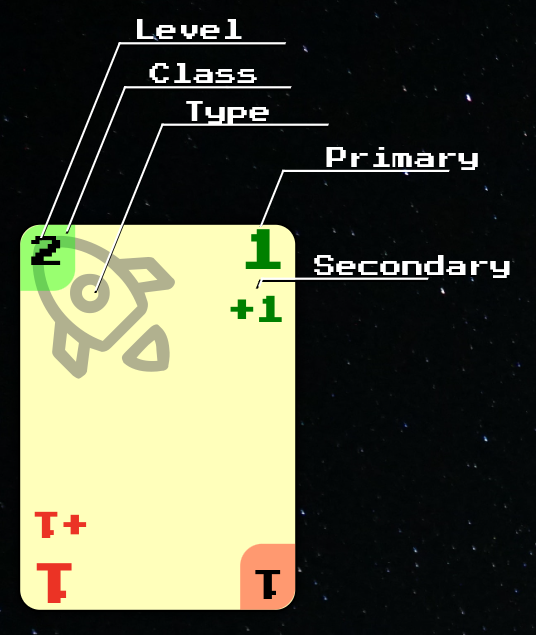

```
          ╭──╥─╥──────╮ Strong End    ╭───────────╮ Hidden End
Level+EC─►│ 2+1║    1 │ ◄── Primary   │           │
Class ───►╞══╩═╝   +1 │ ◄── Secondary │           │
          │   ship    │               │  faction  │
Type ────►│- -image- -│- - - - - - - -│- -image- -│- - - - - - 
          │    here   │ Weak End      │/// here //│ Damaged End
          │ T+   ╔═╦══╡ ◄── Class     │///////////│
          │ T    ║ᘔ +T│ ◄── Level+EC  │///////////│
          ╰──────╨─╨──╯               ╰───────────╯
```

1. Card properties are:
	1. [[Side]] and [[End]]
	2. [[Faction]] - always visible
	3. [[Class]], which implies:
		1. [[Defense]], default is [[AttackPower]] or **1** for non-[[Military]]
	4. [[Level]], which implies:
		1. [[Capacity]], default is [[Level]]
		2. [[Range]], default is [[Level]] or **0** for [[Structure]]
	5. [[ExtraCost]], which implies:
		1. [[Cost]] = [[Level]] + [[ExtraCost]]
		2. [[Size]] = [[Level]] + [[ExtraCost]] or [[Level]] for [[Hero]]
	6. [[Type]], which implies:
		1. [[Role]]: [[Unit]] / [[Structure]] / [[Agenda]] - always visible
		2. [[Origin]]: [[Social]] / [[Industrial]]
	7. [[PrimaryAbility]]
	8. [[SecondaryAbility]]
	9. [[Trait]]
	10. [[Prerequisites]]
	11. [[CulturePoints]]
2. Kinds of properties:
	1. **explicit** - printed on the card
	2. **implicit** - derived from other properties
	3. **physical** - [[Side]] and [[End]]

#### Notes

1. In the card picture `T` is upside-down `1`: the weak [[End]] is printed rotated by 180°
2. The picture is generic for all double ended cards
