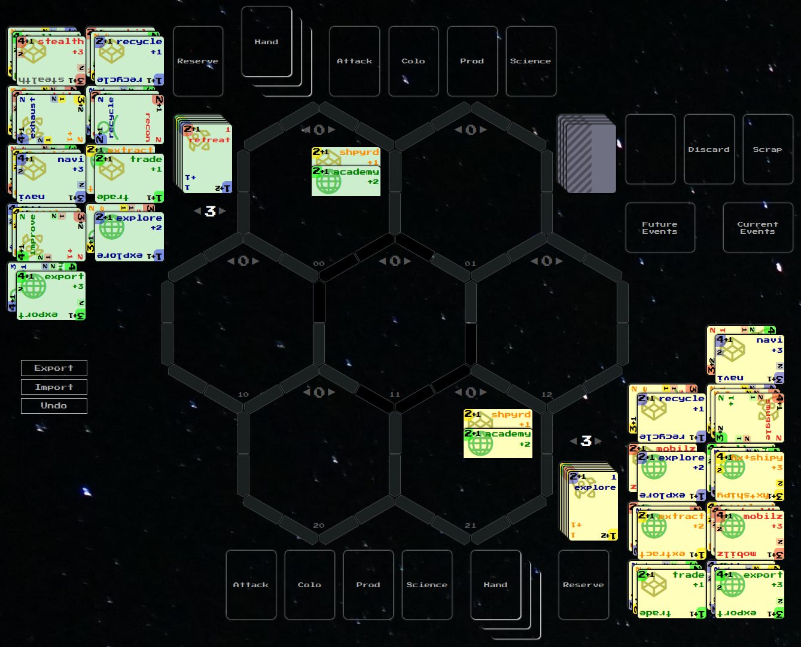

1. 4X strategy with:
	1. Deck building
	2. Worker placement
	3. Engine building
2. Main game rule is [[PerformAction]], start with it
3. These docs are the source of truth for the rules
4. Game is played by 1+ players with different options, see [[Scenario]]
5. First focus: minimal playable duel without the [[GalaxyDeck]], playable with
   AI

#### Inspiration

1. **Star Realms**: deck building and [[Turn]], but more complex: plus a
   [[Field]]
2. **Twilight Imperium**: 4X on a [[Field]], but faster: simpler turns, politics
   as an extension
3. **Chess**: even contest, no luck in [[Combat]], see [[GameBalance]]; losing
   all [[Hero]]es is checkmate, see [[Goal]]

#### Scopes

Every page states its `scope` in frontmatter:

1. `core` - minimal playable game
2. `advanced` - more technologies and rules on top of core
3. Extensions:
	1. `galaxy` - [[Galaxy]] deck: [[Event]]s, [[Alien]]s, [[Derelict]]s
	2. `objectives` - [[Objective]]s and victory points
	3. `politics` - [[Politics]]
4. `meta` - reviews and documentation support
5. `idea` - out of the rules, kept in `ideas/` for later

#### Status

Every page states its `status` in frontmatter:

1. `stub` - empty or unfinished
2. `draft` - written, not approved
3. `stable` - approved
4. `WIP` - active review
