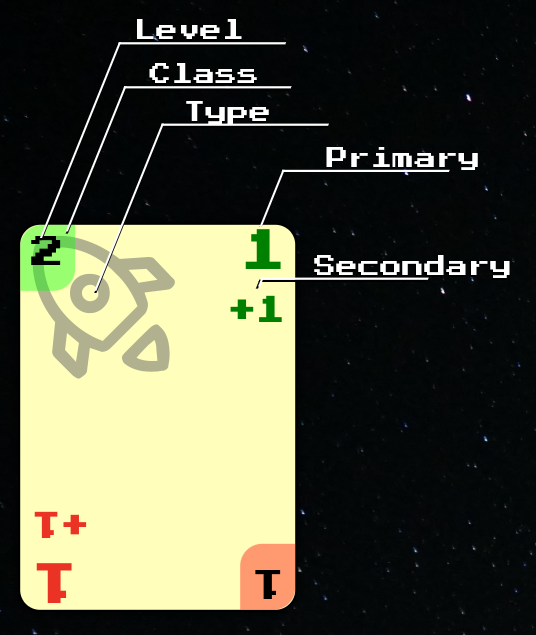

```
          ╭──╥─╥──────╮ Strong End    ╭───────────╮ Hidden End
Level+EP─►│ 2+1║    1 │ ◄── Primary   │           │
Class ───►╞══╩═╝   +1 │ ◄── Secondary │           │
          │   ship    │               │  faction  │
Type ────►│- -image- -│- - - - - - - -│- -image- -│- - - - - - 
          │    here   │ Weak End      │/// here //│ Damaged End
          │ T+   ╔═╦══╡ ◄── Class     │///////////│ (dashed)
          │ T    ║ᘔ +T│ ◄── Level+EP  │///////////│
          ╰──────╨─╨──╯               ╰───────────╯
```

1. [[Card]] **Properties** by kind:
	1. **physical**: [[Side]], [[End]]
	2. **explicit**, printed on the [[Card]]: [[Faction]], [[Class]],
	   [[Level]], [[ExtraPrice]], [[Type]], [[PrimaryAbility]],
	   [[SecondaryAbility]], [[Trait]], [[Prerequisites]]
	3. **implicit**, derived from other **Properties**: [[Defense]],
	   [[Capacity]], [[Range]], [[Price]], [[Size]], [[Role]],
	   [[Origin]]
2. [[Component]] **Properties**, of [[Card]]s and [[Tile]]s: [[Side]],
   [[Price]]

#### Notes

1. In the [[Card]] picture `T` is upside-down `1`: the [[Weak]]
   [[End]] is printed rotated by 180°
2. The picture is generic for all double ended [[Card]]s
