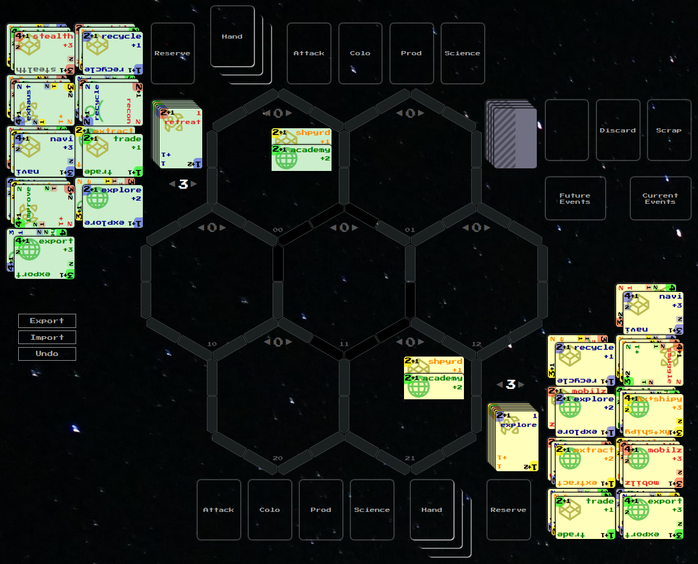

1. [[Card]]-driven spatial 4X with [[DeckBuilding|deck building]] and
   engine building
2. Main game rule is [[PerformAction]], start with it
3. These docs are the source of truth for the rules
4. Game is played by 1+ players with different options, see
   [[Scenario]]
5. First focus: the [[Duel]], minimal playable game without the
   [[GalaxyDeck]], playable with AI

#### Inspiration

1. **Star Realms**: deck building and [[Turn]], but more complex: plus
   a [[Field]]
2. **Twilight Imperium**: 4X on a [[Field]], but faster: simpler
   [[Turn]]s, politics as an extension
3. **Chess**: even contest, no luck in [[Combat]], see
   [[GameBalance]]; losing all [[Hero]]es is checkmate, see
   [[PaxGalactica|Pax Galactica]]

#### Modules

Every page of the rules states its module as `scope` in frontmatter,
see [[Docs]]:

1. `core` - streamlined rules, independent of a [[Faction]] deck, a
   [[Technology]] and a [[Scenario]]
	1. Core is an extensible framework: it gives core numbers, e.g.
	   the [[Hand]] size, and a [[Faction]] or any [[Card]] can change
	   any rule, the change lives on its own page
2. `duel` - minimal playable game on top of core: the [[Duel]] setup,
   the Human and Alien [[Deck]] and its [[Technology|Technologies]]
3. `advanced` - more [[Technology|Technologies]] and rules on top of
   duel
4. Extensions:
	1. `events` - the [[Galaxy]] plays its [[GalaxyDeck]]:
	   [[Event]]s, [[Derelict]]s, [[WarpStorm|Warp storm]]s
	2. `objectives` - [[Objective]]s, [[History]] and [[Legacy]]
	3. `politics` - [[Politics]]
